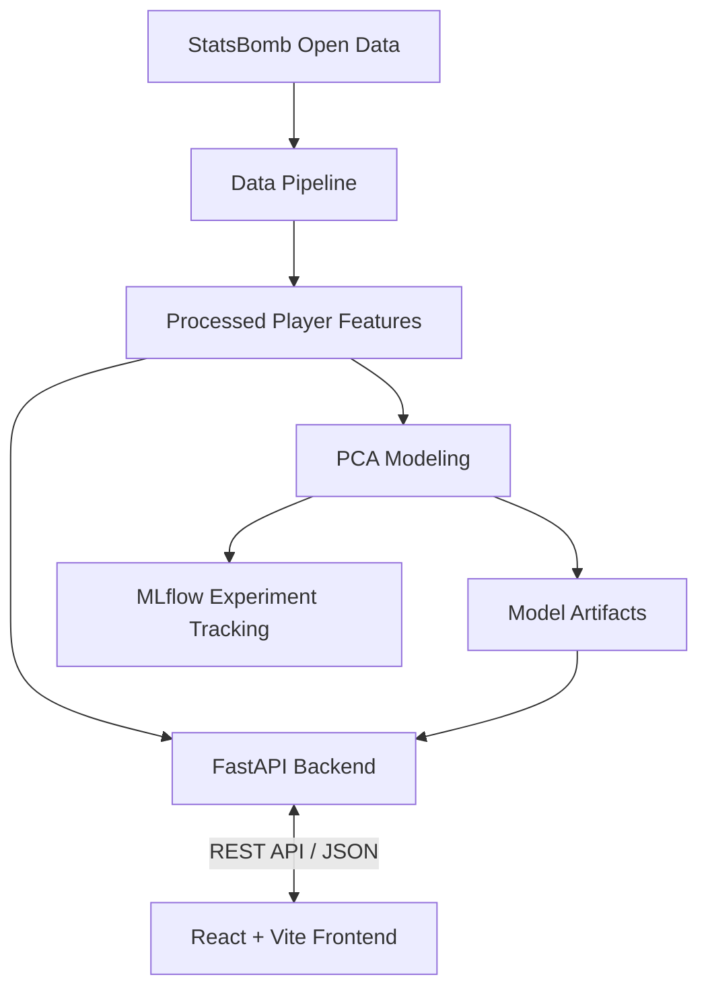
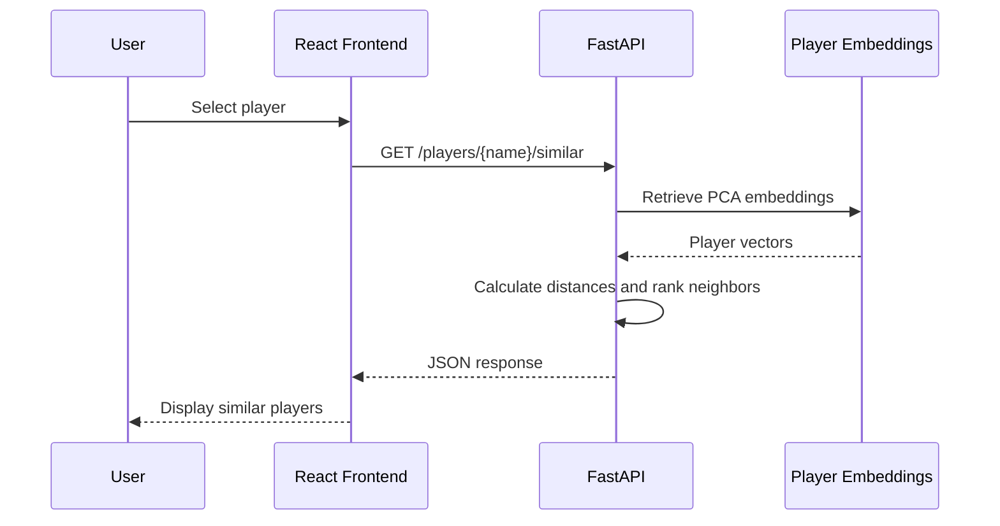

# System Architecture

StatXavi is a full-stack soccer analytics application that transforms StatsBomb event data into interactive player profiles, statistical comparisons, and PCA-based similarity recommendations.

The application consists of four primary layers:

1. **Data Pipeline:** Ingests, cleans, and aggregates StatsBomb event data.
2. **Modeling:** Generates PCA player embeddings and evaluates similarity models.
3. **Backend API:** Serves player statistics, model outputs, and similarity calculations.
4. **Frontend:** Provides an interactive interface for exploring player analytics.

## 1. Architecture Overview



StatXavi follows an **offline processing / online serving** architecture.

Data ingestion, feature engineering, and model training occur independently of user requests. The backend loads precomputed datasets and model artifacts, avoiding expensive processing during API requests.

## 2. Component Responsibilities

| Component | Technologies | Responsibility |
|---|---|---|
| Data Pipeline | Python, Pandas | Ingest, clean, and aggregate event data |
| Feature Engineering | Python, Pandas | Generate player-season statistical features |
| Modeling | scikit-learn | Standardize features and generate PCA embeddings |
| Experiment Tracking | MLflow | Evaluate and compare model configurations |
| Data Storage | Parquet, Pickle | Persist processed datasets and model artifacts |
| Backend | FastAPI | Serve player data, statistics, and similarity calculations |
| Frontend | React, Vite | Render interactive player profiles and visualizations |

### Data Pipeline & Modeling

The offline pipeline transforms raw StatsBomb event data into player-season features and PCA embeddings.

Processed datasets and fitted model artifacts are persisted locally for use by the backend.

### Backend API

The FastAPI backend provides a REST interface between stored analytical artifacts and the frontend.

Its responsibilities include:

- Player search and metadata retrieval
- Player statistics and percentile calculations
- PCA-based nearest-neighbor retrieval
- Player-to-player feature comparisons
- PCA component metadata retrieval

The backend performs lightweight calculations against precomputed datasets rather than executing the full processing pipeline.

### Frontend

The React frontend communicates with FastAPI through HTTP requests and JSON responses.

It provides:

- Player search and profiles
- Position-relative percentile visualizations
- Similar-player discovery and filtering
- Side-by-side player comparisons
- Interactive PCA visualizations

The frontend handles presentation and user interaction, while analytical calculations remain in the backend.

## 3. Data Storage

StatXavi currently uses filesystem-based storage for processed datasets and model artifacts.

```text
data/
├── raw/
├── processed/
└── model/

models/
└── pca/
```

**Parquet** stores tabular analytical datasets, while serialized model artifacts preserve fitted transformations for reuse.

This approach minimizes infrastructure complexity while supporting the application's current read-heavy workload.

## 4. Request Lifecycle

A typical player similarity request follows this sequence:



This design keeps the frontend independent of the underlying modeling implementation.

## 5. Key Architectural Decisions

| Decision | Rationale |
|---|---|
| Offline data processing and model fitting | Avoid expensive computations during API requests |
| Precomputed analytical artifacts | Reduce latency and ensure consistent model outputs |
| File-based storage | Minimize infrastructure overhead for relatively small datasets |
| Separate FastAPI backend | Centralize analytical logic and expose reusable REST endpoints |
| React frontend | Support interactive visualizations and component-based development |
| MLflow experiment tracking | Maintain reproducibility and compare modeling configurations |

## 6. Future Scalability

StatXavi's modular architecture allows data processing, model training, API serving, and frontend presentation to evolve independently.

Potential infrastructure improvements include:

- **Cloud Storage:** Migrate datasets and model artifacts to Amazon S3.
- **Pipeline Orchestration:** Automate ingestion, feature engineering, and model training.
- **Containerization:** Package backend and pipeline workloads using Docker.
- **CI/CD:** Automate testing and deployment using GitHub Actions.
- **Cloud Compute:** Execute data-processing workloads using AWS services.

These improvements can be introduced incrementally without fundamentally restructuring the application.

## Related Documentation

- [Data Pipeline](data-pipeline.md) — Data ingestion, processing stages, and pipeline execution.
- [Feature Engineering](feature-engineering.md) — Statistical features, transformations, and aggregation logic.
- [Modeling](modeling.md) — PCA methodology, similarity calculations, and model evaluation.