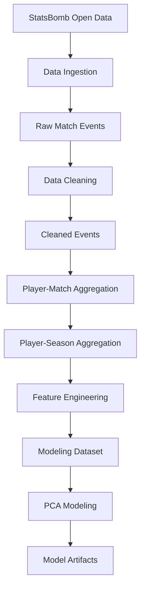

# Data Pipeline

StatXavi uses a Python-based data pipeline to transform raw StatsBomb event data into structured player-level datasets for statistical analysis and machine learning.

The pipeline processes data by competition and season, separating ingestion, cleaning, feature engineering, and modeling into distinct stages.

## 1. Pipeline Overview



The pipeline follows an **offline batch-processing architecture**. Data preparation and model training occur independently of API requests, with processed outputs persisted for downstream use.

## 2. Pipeline Stages

| Stage | Module | Responsibility |
|---|---|---|
| Ingestion | `src/ingest.py` | Retrieve StatsBomb match events and player-position information |
| Cleaning | `src/clean.py` | Normalize raw event data and prepare structured datasets |
| Aggregation | `src/features.py` | Aggregate event statistics into player-match and player-season records |
| Feature Engineering | `src/features.py` | Calculate per-90 rates and derived performance metrics |
| Modeling | PCA pipeline | Standardize features, fit PCA, and generate player embeddings |

### Data Ingestion

The ingestion stage retrieves publicly available StatsBomb data for a specified competition and season.

Raw event data and player-position information are stored locally, preserving the original source data for reproducibility.

### Data Cleaning

Raw match events are normalized into a consistent structure suitable for aggregation.

This stage prepares event attributes and handles relevant missing or inconsistent values before downstream processing.

### Player-Level Aggregation

Cleaned events are aggregated at two levels:

1. **Player-Match:** Event statistics are summarized for each player within an individual match.
2. **Player-Season:** Match-level records are combined into season-level player profiles.

Player-season records also incorporate playing time, team information, and positional metadata.

### Feature Engineering

Aggregated statistics are transformed into standardized analytical features, including per-90 rates and derived performance metrics.

### Modeling

The resulting player-season dataset is used to fit PCA models and generate player embeddings.

## 3. Data Storage

The pipeline organizes datasets by competition and season.

```text
data/
├── raw/
│   └── <competition>/
│       └── <season>/
│
├── processed/
│   └── <competition>/
│       └── <season>/
│
└── model/
    └── <season>/

models/
└── pca/
    └── <season>/
```

Processed tabular datasets are persisted in Parquet format, enabling efficient storage and retrieval with Pandas.

Separating raw data, processed datasets, and model artifacts supports reproducibility and simplifies debugging.

## 4. Pipeline Design Decisions

| Decision | Rationale |
|---|---|
| Competition-season partitioning | Organize datasets and support incremental processing |
| Separate ingestion and cleaning stages | Preserve raw data and isolate transformation logic |
| Player-match intermediate datasets | Enable reusable aggregation and validation |
| Parquet storage | Provide efficient columnar storage for analytical workloads |
| Offline batch processing | Avoid expensive data transformations during API requests |
| Modular Python scripts | Support independent development and testing of pipeline stages |

## 5. Future Improvements

Potential enhancements include:

- **Pipeline Orchestration:** Automate stage execution and dependency management.
- **Data Validation:** Introduce automated schema and data-quality checks.
- **Cloud Storage:** Migrate raw and processed datasets to Amazon S3.
- **Containerization:** Package pipeline dependencies using Docker.
- **Automated Execution:** Run scheduled ingestion and processing jobs in AWS.

These improvements would support more reliable processing as StatXavi expands to additional competitions and seasons.

## Related Documentation

- [System Architecture](architecture.md) — Overall application architecture and component responsibilities.
- [Feature Engineering](feature-engineering.md) — Statistical features, transformations, and aggregation logic.
- [Modeling](modeling.md) — PCA methodology, player similarity, and model evaluation.