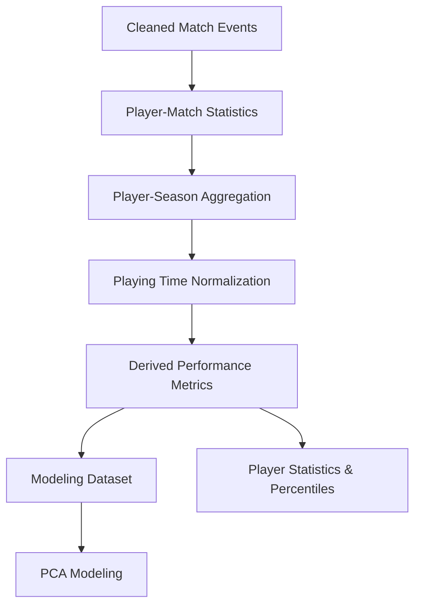

# Feature Engineering

StatXavi transforms StatsBomb event-level data into player-season statistical profiles used for player comparisons, percentile visualizations, and PCA-based similarity modeling.

Feature engineering is implemented primarily in `src/features.py` and focuses on constructing interpretable, playing-time-adjusted performance metrics.

## 1. Feature Engineering Overview

Features are aggregated at the player-season level, with each record representing a player's statistical performance within a specific competition and season.

## 2. Player-Level Aggregation

### Player-Match Features

Cleaned match events are aggregated into player-match records containing performance statistics such as:

- Passes attempted and completed
- Progressive passes and carries
- Shots, expected goals (xG), and assists
- Tackles, interceptions, and pressures
- Playing time and positional information

### Player-Season Features

Player-match records are aggregated into player-season profiles.

Each record includes:

- Player, team, competition, and season identifiers
- Matches played, starts, and total minutes
- Primary playing position and position group
- Aggregated attacking, passing, progression, and defensive statistics

This structure provides a consistent unit of analysis for player comparisons and modeling.

## 3. Feature Normalization

### Per-90 Statistics

Raw event counts are normalized by playing time to support comparisons between players with different minutes played.

For a given statistic:

$$
X_{per90} = \frac{X_{total}}{MinutesPlayed} \times 90
$$

For example, a player completing 120 progressive passes across 1,800 minutes would have:

$$
ProgressivePasses_{per90} = \frac{120}{1800} \times 90 = 6.0
$$

Per-90 normalization is applied to relevant counting statistics before modeling.

### Derived Metrics

Additional features are constructed from combinations of raw statistics to capture aspects of player performance beyond event volume.

Examples include:

| Feature | Calculation | Purpose |
|---|---|---|
| Pass Completion Rate | Completed Passes / Attempted Passes | Passing efficiency |
| Progressive Passes per 90 | Progressive Passes / Minutes × 90 | Passing progression |
| Progressive Carries per 90 | Progressive Carries / Minutes × 90 | Ball-carrying progression |
| Shots per 90 | Shots / Minutes × 90 | Shooting activity |
| xG per 90 | Total xG / Minutes × 90 | Expected scoring output |
| Interceptions per 90 | Interceptions / Minutes × 90 | Defensive activity |

Ratio-based features are calculated only when their denominators are valid.

## 4. Position Group Mapping

Individual StatsBomb positions are mapped into broader positional categories using `utils.POSITION_GROUPS`.

Examples include:

| StatsBomb Position | Position Group |
|---|---|
| Right Back | Fullback |
| Left Wing Back | Fullback |
| Right Center Back | Center Back |
| Defensive Midfield | Defensive Midfielder |
| Center Midfield | Central Midfielder |
| Right Wing | Winger |
| Center Forward | Striker |

Position groups support:

- Position-relative percentile calculations
- Position-filtered similarity recommendations
- Comparisons between players occupying similar roles

The PCA model is fitted across eligible players rather than independently for each position group.

## 5. Modeling Eligibility

To reduce statistical noise from limited playing time, players must satisfy a minimum threshold of **600 minutes played** to enter the PCA modeling dataset.

This threshold helps prevent inflated or unreliable per-90 statistics from disproportionately influencing the model.

Players below the threshold are excluded from PCA fitting.

## 6. Feature Standardization

Before PCA fitting, numerical features are standardized using scikit-learn's `StandardScaler`.

For each feature:

$$
z = \frac{x - \mu}{\sigma}
$$

Where:

- $x$ is the original feature value
- $\mu$ is the feature mean
- $\sigma$ is the feature standard deviation

Standardization ensures that features with larger numerical scales do not dominate PCA.

The fitted scaler is persisted alongside the PCA model to maintain consistent transformations.

## 7. Design Decisions

| Decision | Rationale |
|---|---|
| Player-season aggregation | Provide a consistent unit for comparing player performance |
| Per-90 normalization | Account for differences in playing time |
| Derived statistical features | Capture performance characteristics beyond raw event counts |
| Minimum minutes threshold | Reduce noise from small sample sizes |
| Position group mapping | Enable meaningful comparisons across similar playing roles |
| Feature standardization | Ensure comparable feature scales before PCA |

## Related Documentation

- [System Architecture](architecture.md) — Application components and data flow.
- [Data Pipeline](data-pipeline.md) — Data ingestion, cleaning, and aggregation.
- [Modeling](modeling.md) — PCA fitting, similarity calculations, and model evaluation.