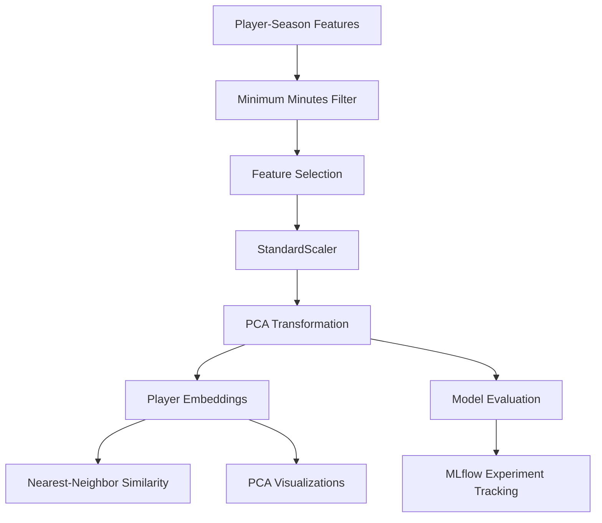

# Modeling

StatXavi uses Principal Component Analysis (PCA) to represent soccer players in a lower-dimensional statistical space and identify players with similar performance profiles.

The modeling pipeline uses standardized player-season features to generate PCA embeddings, which are subsequently used for nearest-neighbor similarity calculations and interactive visualizations.

## 1. Modeling Overview

Model training occurs offline, with fitted transformations and player embeddings persisted for use by the FastAPI backend.

## 2. PCA Methodology

### Feature Standardization

Selected numerical features are standardized using scikit-learn's `StandardScaler`:

$$
z = \frac{x - \mu}{\sigma}
$$

This prevents features with larger numerical scales from disproportionately influencing PCA.

### Dimensionality Reduction

PCA transforms the standardized feature matrix into a smaller set of orthogonal principal components.

Each component captures a direction of variance within the original feature space.

The model currently generates **10 principal components**, producing a player embedding of the form:

$$
Player_i = [PC_1, PC_2, \ldots, PC_{10}]
$$

These embeddings provide a compact representation of each player's statistical profile.

## 3. Player Similarity

Player similarity is calculated using Euclidean distance between PCA embeddings.

For players $A$ and $B$:

$$
d(A,B) = \sqrt{\sum_{i=1}^{k}(PC_{i,A} - PC_{i,B})^2}
$$

Where $k$ is the number of principal components used in the similarity calculation.

Smaller distances indicate greater similarity within the modeled feature space.

### Nearest-Neighbor Retrieval

Given a selected player, the similarity workflow:

1. Retrieves the player's PCA embedding.
2. Calculates Euclidean distances to other eligible players.
3. Applies optional position-group filtering.
4. Sorts candidates by ascending distance.
5. Returns the top $N$ nearest neighbors.

Position filtering is applied during retrieval rather than by fitting separate PCA models for each position group.

This allows both cross-position and position-restricted comparisons within a shared statistical space.

## 4. Model Evaluation

StatXavi uses MLflow to track PCA experiments and compare model configurations.

Evaluation focuses on dimensionality reduction quality and the preservation of meaningful player relationships.

| Metric | Purpose |
|---|---|
| Explained Variance | Measures the proportion of original variance retained by PCA |
| Trustworthiness | Evaluates preservation of local neighborhoods |
| Neighborhood Preservation | Measures overlap between neighbors in original and reduced feature spaces |
| Position-Group Consistency | Evaluates positional similarity among nearest neighbors |

Experiments compare different numbers of principal components to assess the tradeoff between dimensionality reduction and similarity quality.

Model selection considers both quantitative evaluation metrics and qualitative inspection of nearest-neighbor results.

## 5. Model Interpretability

### PCA Loadings

PCA loadings describe the contribution of original standardized features to each principal component.

StatXavi exposes the features with the largest absolute loadings for each component, allowing users to better understand the statistical patterns represented by PCA axes.

For a given component, features are ranked by:

$$
Importance_{feature} = |Loading_{feature}|
$$

The frontend displays these influential features when users interact with PCA axis labels.

### PCA Visualization

The frontend provides an interactive scatterplot of player embeddings along selected principal-component axes.

This allows users to explore:

- Statistical proximity between players
- Broad patterns in player performance
- Differences between positional groups
- The characteristics represented by individual components

Two-dimensional PCA visualizations are projections of the full embedding space and do not necessarily preserve all relationships used in similarity calculations.

## 6. Model Artifacts

The modeling pipeline persists fitted transformations and generated embeddings for downstream use.

| Artifact | Purpose |
|---|---|
| StandardScaler | Preserve feature standardization parameters |
| PCA Model | Transform standardized features into principal components |
| Player Embeddings | Support nearest-neighbor similarity calculations |
| PCA Loadings | Support component interpretation and visualization |
| Model Metadata | Record model configuration and relevant parameters |

The FastAPI backend loads these precomputed artifacts rather than fitting models during API requests.

## 7. Modeling Decisions & Limitations

| Decision | Rationale |
|---|---|
| PCA dimensionality reduction | Reduce feature redundancy while preserving major patterns of variance |
| Shared PCA model | Enable comparisons across all eligible position groups |
| Euclidean distance | Provide a simple, interpretable similarity measure |
| Offline model fitting | Reduce API latency and maintain consistent embeddings |
| MLflow evaluation | Track experiments and support reproducible model selection |
| Minimum playing-time threshold | Reduce statistical noise from limited observations |

### Limitations

- **Variance vs. similarity:** PCA maximizes retained variance, which does not necessarily correspond to meaningful soccer-specific similarity.
- **Position effects:** A shared PCA model may emphasize differences between playing positions rather than subtle differences within positions.
- **Data coverage:** Similarity results depend on the competitions, seasons, and players represented in the modeling dataset.
- **Interpretability:** Principal components represent combinations of statistical features rather than directly observable playing characteristics.

## Related Documentation

- [System Architecture](architecture.md) — Application components and data flow.
- [Data Pipeline](data-pipeline.md) — Data ingestion, cleaning, and processing.
- [Feature Engineering](feature-engineering.md) — Statistical features, transformations, and eligibility criteria.